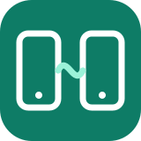
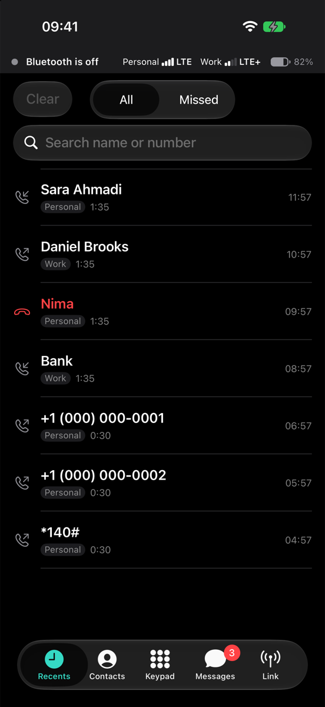
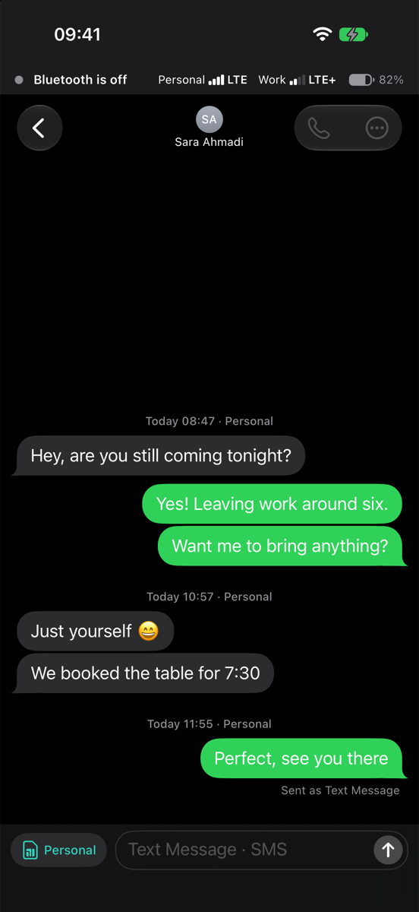
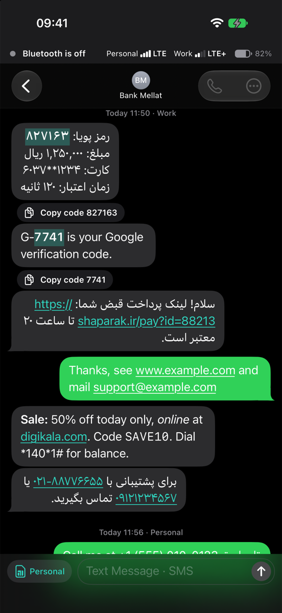
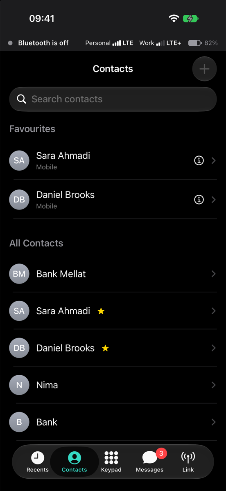
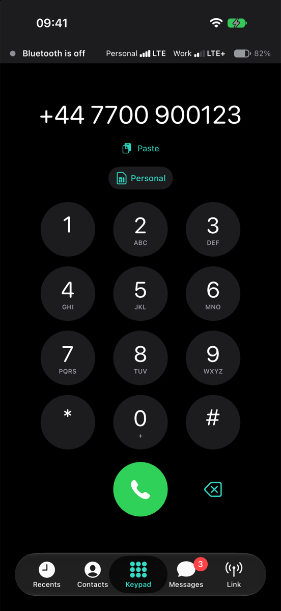
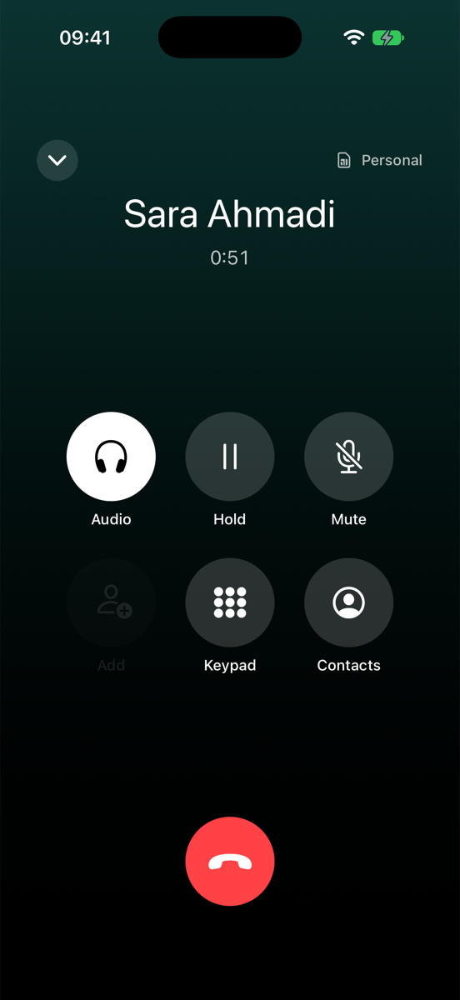
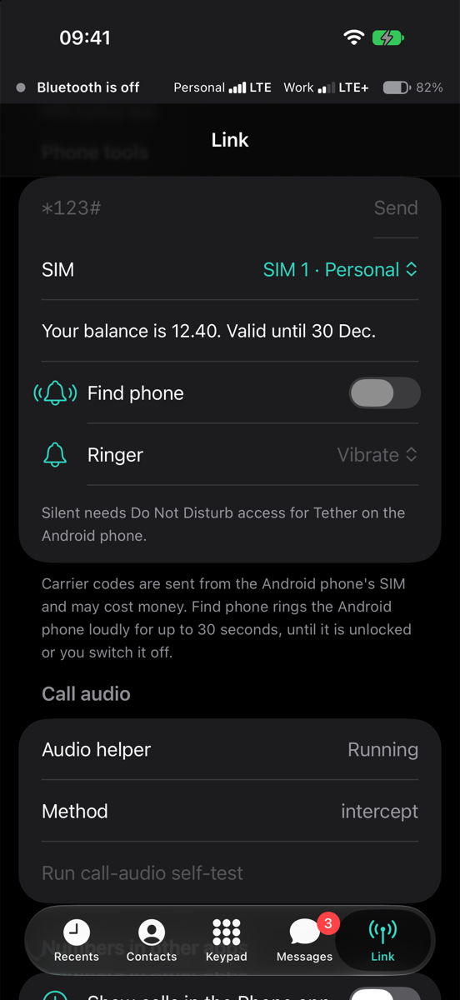
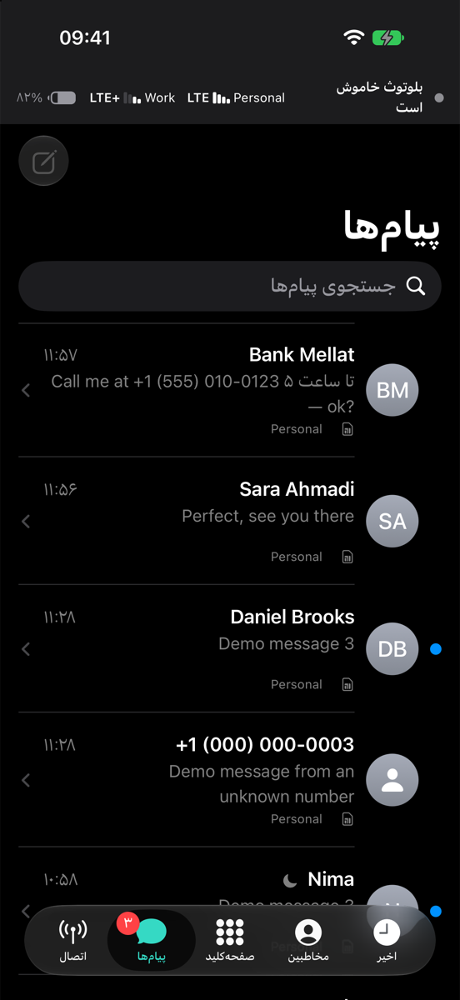
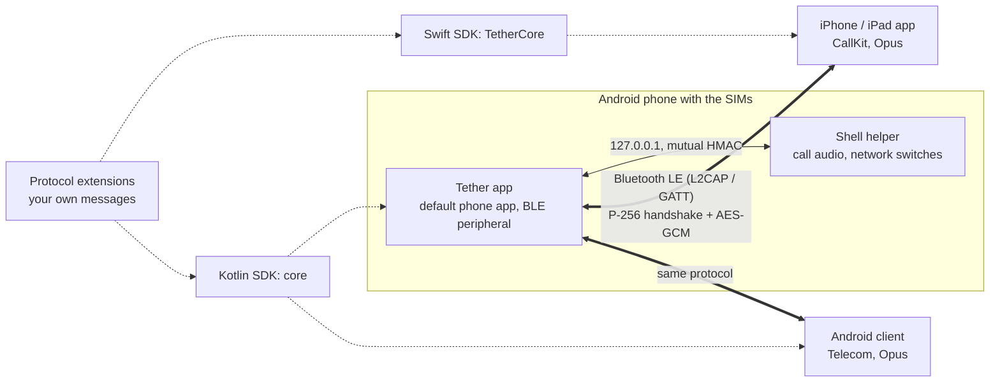

<p align="center">
  
</p>

<h1 align="center">Tether</h1>

<p align="center"><b>Your Android phone's calls, texts, contacts and call history on your iPhone, iPad or a second
Android phone, over an end-to-end encrypted Bluetooth link. No server, no account.</b></p>

<p align="center">
  <a href="https://github.com/amirwmr/tether/actions/workflows/ci.yml"></a>
  <a href="https://github.com/amirwmr/tether/releases/latest"></a>
  <a href="LICENSE"></a>
  
  
  
  <br>
  <a href="docs/SDK-swift.md"></a>
  <a href="docs/SDK-kotlin.md"></a>
  <a href="CONTRIBUTING.md"></a>
  
</p>

<p align="center">
  <a href="#download">Download</a> ·
  <a href="docs/INSTALL.md">Install guide</a> ·
  <a href="docs/FAQ.md">FAQ</a> ·
  <a href="docs/fa/README.md">فارسی</a> ·
  <a href="#build-on-tether">Build on Tether</a> ·
  <a href="#documentation">Docs</a> ·
  <a href="docs/ROADMAP.md">Roadmap</a> ·
  <a href="CONTRIBUTING.md">Contribute</a>
</p>

<div dir="rtl" lang="fa">

**فارسی:** تتر تماس‌ها، پیامک‌ها، مخاطبین و تاریخچهٔ تماس گوشی اندرویدیِ سیم‌کارت‌دار شما را روی آیفون (یا یک گوشی
اندرویدی دیگر) می‌آورد؛ از طریق بلوتوث، با رمزنگاری سرتاسری، بدون سرور و بدون حساب کاربری. برای نصب به مک نیاز
ندارید. [راهنمای کامل فارسی: دانلود، نصب، راه‌اندازی](docs/fa/README.md) · [پرسش‌های رایج](docs/fa/faq.md)

</div>

## What it is, and why

Carry two SIMs but only want one phone in your hand? Tether makes an Android phone the SIM holder: it stays in a bag
and becomes the default phone app, while your iPhone (or a second Android phone) rings, dials, texts and shows your
contacts and history through its own native screens. The phones talk directly over Bluetooth LE, every session is
end-to-end encrypted with keys exchanged by a QR code, and nothing goes through a server or an account.

Under the apps sit reusable libraries in Swift and Kotlin and a documented, versioned protocol, so you can build
other clients and tools on the same link.

<table>
  <tr>
    <td align="center"><br><sub>Recents</sub></td>
    <td align="center"><br><sub>A conversation</sub></td>
    <td align="center"><br><sub>One-time codes</sub></td>
    <td align="center"><br><sub>Contacts</sub></td>
  </tr>
  <tr>
    <td align="center"><br><sub>Keypad</sub></td>
    <td align="center"><br><sub>In a call</sub></td>
    <td align="center"><br><sub>Phone tools</sub></td>
    <td align="center"><br><sub>Persian</sub></td>
  </tr>
</table>

*Screenshots from the iOS simulator with demo data (test numbers and made-up names).*

## What works

- **Calls** through the iPhone's own call screen (CallKit): incoming ringing, answer, decline, dial, hang up, hold,
  mute, keypad tones, speaker, call waiting, "move the call here" between devices. Call audio is bridged both ways
  (Opus, wideband) on Android phones that allow it, see [Compatibility](#compatibility). An **Audio** menu moves a
  call to a Bluetooth headset or the car and back.
- **Numbers from other apps**: a "Call with" action for Shortcuts and Siri (also finds a number in shared text),
  `tether://dial` links, call-backs from the Phone app's Recents, and on iOS 18.2+ with a paid developer account,
  the default calling app for `tel:` links. Numbers are grouped like phones show them, on the keypad as you type.
- **Messages** (SMS): every conversation, live new texts, send from either SIM, read state shared with the Android
  phone, delete, mute, block, one-time codes with a Copy button, links and phone numbers recognised.
- **Contacts**: browse, search, edit, add, favourites; **Recents**: search, delete, clear, missed-call badge.
- **Notifications** for texts and missed calls, with quick reply.
- **Link tab**: battery and signal of each SIM, and remote switches for mobile data, the data SIM, Wi-Fi hotspot,
  Bluetooth tethering, airplane mode, network mode, and "Share VPN" (use the Android phone's VPN from the iPhone).
- **Phone tools**: carrier codes such as a balance check (USSD) on either SIM, "Find phone" (the Android phone rings
  loudly) and its ringer mode.
- English and Persian (right to left), in a dark design.

### On a second Android phone

The **Android client** (`android/client`, "Tether Client") does the same on another Android phone (Android 10 or
later): pairing by QR code, calls through Android's own call system (Bluetooth headsets and the car included) with
audio both ways, the keypad, Recents, Contacts and Favourites, Messages, notifications, the Link screen and its
switches, and "Call with" for `tel:` links in other apps. See [docs/ANDROID-CLIENT.md](docs/ANDROID-CLIENT.md); it is
tested on the build machine only so far (against a simulated Android phone), not yet on a second phone.

## How it fits together



More in [docs/ARCHITECTURE.md](docs/ARCHITECTURE.md); the wire format is [protocol/PROTOCOL.md](protocol/PROTOCOL.md).

## Download

**Step-by-step guide: [docs/INSTALL.md](docs/INSTALL.md)** · [راهنمای فارسی](docs/fa/README.md) · [FAQ](docs/FAQ.md)

Get the files from the [latest release](https://github.com/amirwmr/tether/releases/latest):

| File | Install it on |
| --- | --- |
| `Tether-A54-<version>.apk` | **The Android phone with the SIM cards** (any Android 8+ phone; it becomes the default phone app). Everyone needs this one |
| `Tether-<version>-unsigned.ipa` | **Your iPhone or iPad** (iOS 16+), sideloaded with your own Apple ID: [SideStore, AltStore, Sideloadly or TrollStore](docs/INSTALL.md#4-install-the-iphone-app). No Mac needed |
| `Tether-Client-<version>.apk` | **A second Android phone** in your hand instead of an iPhone |

**AltStore / SideStore source** (add it once, then install and update from the app):
`https://github.com/amirwmr/tether/releases/latest/download/altstore.json`

With a free Apple ID the iPhone app has to be refreshed every 7 days (data and pairing are kept). Prefer to build it
yourself? See [Quick start](#quick-start) and [docs/BUILD.md](docs/BUILD.md).

## What you need

| | |
| --- | --- |
| Android phone | Android 8.0 or later with Bluetooth LE advertising (Android 8–9 link over GATT only). Call audio needs Android 11 or later (full support on 13+) and a build that lets the shell user capture call audio; see [features by Android version](docs/devices/android-versions.md). Tether becomes its default phone app. |
| iPhone or iPad | iOS 16 or later. |
| Or a second Android phone | Android 10 or later with Bluetooth LE, for the Android client. |
| A computer | Only for the iPhone, once: a Mac or a Windows PC to set up the sideloading tool. To build the apps yourself: a Mac with Xcode, [XcodeGen](https://github.com/yonaskolb/XcodeGen), JDK 17 and the Android SDK. |
| Not possible | An iPhone as the SIM phone: iOS lets no app control the iPhone's own calls and texts. |

## Quick start

```bash
git clone https://github.com/amirwmr/tether.git && cd tether
cp ios/Config/Local.xcconfig.example ios/Config/Local.xcconfig   # set your team id and a unique bundle id
cd android && ./gradlew :app:assembleRelease && adb install -r app/build/outputs/apk/release/app-release.apk && cd ..
tools/reinstall-ios.sh                                            # builds, signs and installs on your iPhone
```

Then follow [docs/SETUP.md](docs/SETUP.md): open Tether on the Android phone, grant what it asks, make it the
default phone app, pair Wireless debugging for call audio, and scan its QR code from the iPhone.

## Build on Tether

| | |
| --- | --- |
| [Swift SDK](docs/SDK-swift.md) | `TetherCore` as a Swift package: handshake, sealed records, messages, the CoreBluetooth link |
| [Kotlin SDK](docs/SDK-kotlin.md) | The shared Kotlin core (crypto, records, messages, codecs) for Android and the JVM via JitPack |
| [Extending the protocol](docs/EXTENDING.md) | Adding your own message types without breaking installed apps |
| [Protocol](protocol/PROTOCOL.md) | The wire format, with test vectors and fixtures both implementations reproduce |
| [Examples](examples/) | Small programs that use the SDKs |

API reference (Swift DocC and Kotlin Dokka) is published with the [documentation site](https://amirwmr.github.io/tether/).

### Who uses Tether

Built something on Tether? Open a pull request that adds it here.

- *Your project here*

## Documentation

| | |
| --- | --- |
| [INSTALL.md](docs/INSTALL.md) · [FAQ.md](docs/FAQ.md) · [فارسی](docs/fa/README.md) | Download and install without building, sideloading the iPhone app, first call; common questions |
| [BUILD.md](docs/BUILD.md) | Building and installing both apps; Apple accounts, the 7-day signature, team and bundle id |
| [SETUP.md](docs/SETUP.md) | First run on both phones, permissions, Wireless debugging, pairing, the Link switches |
| [USAGE.md](docs/USAGE.md) | Calls, messages, contacts, internet sharing, Share VPN, notifications |
| [TROUBLESHOOTING.md](docs/TROUBLESHOOTING.md) | Not linking, no audio, helper not starting, expiry, which logs to collect |
| [ANDROID-CLIENT.md](docs/ANDROID-CLIENT.md) | The Android client: what it does, building, first run, tests |
| [ARCHITECTURE.md](docs/ARCHITECTURE.md) | How the parts fit together; the wire protocol is in [protocol/PROTOCOL.md](protocol/PROTOCOL.md) |
| [TESTING.md](docs/TESTING.md) | The automatic tests and what each protects, the one-command runner, on-device checks, rules for new code |
| [RELEASING.md](docs/RELEASING.md) | How versions and releases are made |
| [SDK-swift.md](docs/SDK-swift.md) · [SDK-kotlin.md](docs/SDK-kotlin.md) | Using the libraries in your own app |
| [EXTENDING.md](docs/EXTENDING.md) | Protocol extensions |
| [ROADMAP.md](docs/ROADMAP.md) | What comes next |
| [SECURITY.md](SECURITY.md) | Threat model and reporting a vulnerability |
| [CONTRIBUTING.md](CONTRIBUTING.md) · [SUPPORT.md](SUPPORT.md) · [CODE_OF_CONDUCT.md](CODE_OF_CONDUCT.md) · [CHANGELOG.md](CHANGELOG.md) | |

## Compatibility

Tested on one pair only. Everything else is expected from the Android and iOS APIs used, not tried: please report
what you see (open an issue with your phone model, Android version and the Link log).

| Device / feature | Status |
| --- | --- |
| Samsung Galaxy A54, Android 17 (One UI) + iPhone 17 | **Tested**: everything above, including call audio |
| Redmi Note 8 (Qualcomm, custom Android 16) + iPhone 17 Pro (user report, #18) | Calls, texts and call audio work (uplink injected via in-call music `telephony_tx`; phone's microphone stays on) |
| iPad (iOS 16+) | Builds and lays out in the simulator; untested on a device |
| Other Samsung phones, Android 13+ | Expected to work like the A54, including taking the phone's own microphone and earpiece out of a bridged call (redirect audio mode, checked during each call; see [Troubleshooting](docs/TROUBLESHOOTING.md#the-other-side-cannot-hear-me)) |
| Other Android 13+ phones | Calls, messages, contacts and switches expected to work. Call audio works only if the build lets the shell user use the call-audio interception API; the phone's own earpiece is muted during a bridged call (voice-call stream, or each vendor's own audio controls; from their sources, untested on devices; the Link tab shows "Android phone silent"); its microphone is taken out of the call with Android's redirect audio mode where the phone allows it (checked during each call and by the self-test), else it stays on |
| Samsung Galaxy A73 5G, Android 16 (user report, #13) | Calls, texts, switches and two-way call audio work (since 1.2.4, via `capture:intercept` and `inject:telephony_tx`); silencing the A73's own earpiece during a call is still open |
| Android 11-12 | Everything, with call audio on a best-effort path (voice-call capture); untested |
| Android 10 | Everything except call audio; the helper needs the TCP adb path; untested |
| Android 8-9 | Everything except call audio; link over GATT only; the helper only via TCP adb; tested in the emulator, untested on devices |
| Single-SIM phones | Expected to work; SIM choices are hidden |
| Phones without Wi-Fi hotspot or Bluetooth tethering | Those switches are hidden |
| Bluetooth tethering between the same two phones | Works; the link then runs over its GATT transport (see [TROUBLESHOOTING.md](docs/TROUBLESHOOTING.md)) |

Device notes for the test phone, and how to check your own: [docs/devices/galaxy-a54.md](docs/devices/galaxy-a54.md).

## Security in brief

Pairing is a one-time QR code that carries the Android phone's public key and a short-lived token. Every session
starts with a P-256 key agreement that authenticates both sides; everything after it is encrypted with AES-GCM.
Bluetooth's own pairing is not used or trusted. Nothing leaves the two devices. Details and the threat model:
[SECURITY.md](SECURITY.md).

## Limits

- One iPhone or iPad per Android phone at a time is the supported setup. The Android client can be paired next to it
  (protocol §5.1); that combination is untested on devices.
- Bluetooth range: the phones need to stay within a few metres.
- MMS, RCS, group messages, video calls and visual voicemail are not supported.
- iOS apps signed with a free Apple account expire after 7 days: refresh them in SideStore / AltStore / Sideloadly,
  or rebuild with `tools/reinstall-ios.sh`.
- Texts cannot appear in the iPhone's Messages app (iOS allows no app to do that); calls can optionally appear in the
  Phone app's Recents. See the [FAQ](docs/FAQ.md#can-it-fully-integrate-with-the-iphones-phone-and-messages-apps).

## Legal

Use Tether only with your own phones and SIM cards, and follow your local law on recording and handling calls and
messages. Tether does not record calls.

## Contributing

Compatibility reports from phones other than the tested pair are the most useful help right now
([device report](https://github.com/amirwmr/tether/issues/new?template=device_report.yml)). Code, docs and
translations are welcome too: start with [CONTRIBUTING.md](CONTRIBUTING.md) and issues labelled
[good first issue](https://github.com/amirwmr/tether/labels/good%20first%20issue). Everyone taking part follows the
[Code of Conduct](CODE_OF_CONDUCT.md).

## Community and support

Questions go to [a question issue](https://github.com/amirwmr/tether/issues/new?template=question.yml) (after the [FAQ](docs/FAQ.md)), ideas and bugs to
[Issues](https://github.com/amirwmr/tether/issues/new/choose); see [SUPPORT.md](SUPPORT.md) for what to include.
Security problems: privately, as described in [SECURITY.md](SECURITY.md).

## License

MIT, see [LICENSE](LICENSE). Third-party components and their licences: [NOTICE](NOTICE).

## Star history

<a href="https://star-history.com/#amirwmr/tether&Date"></a>
